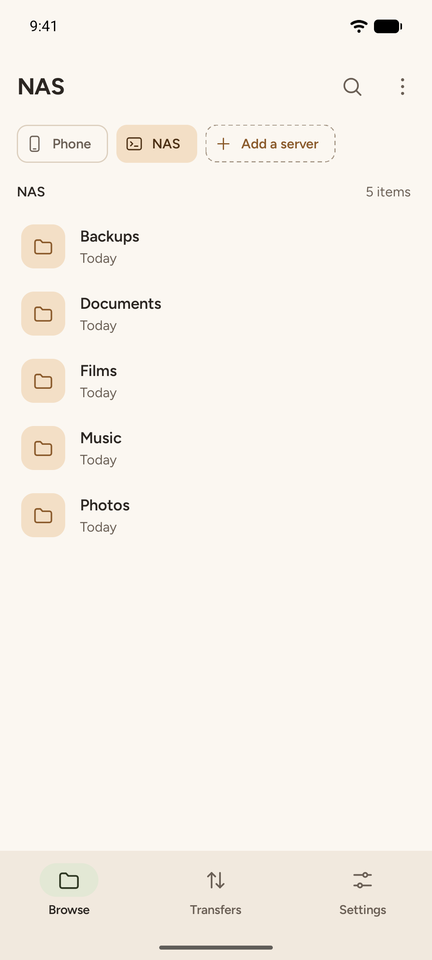
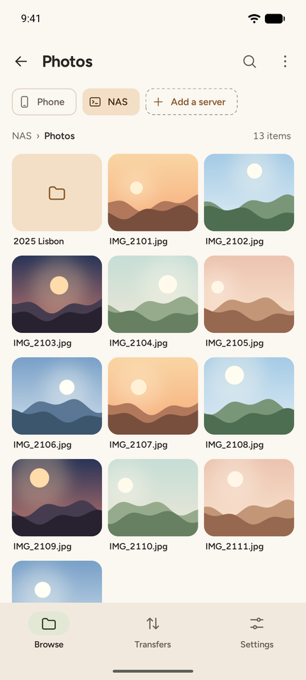
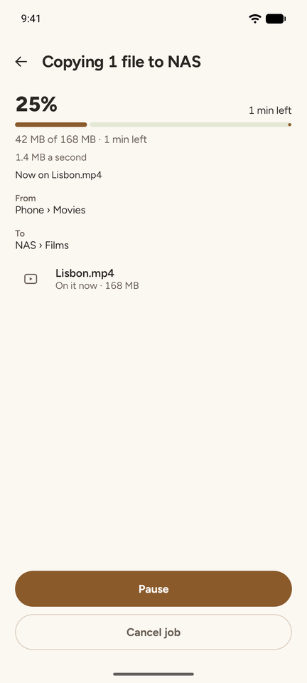
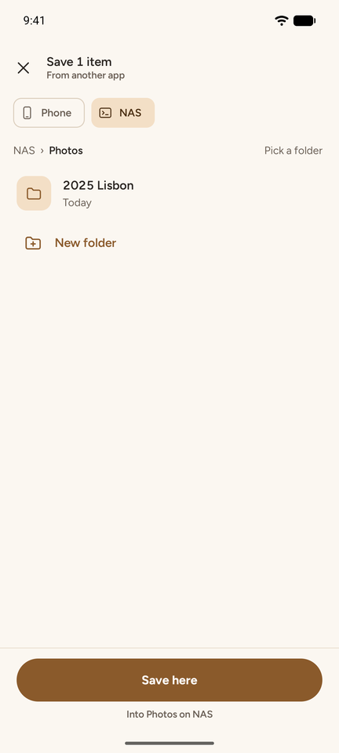
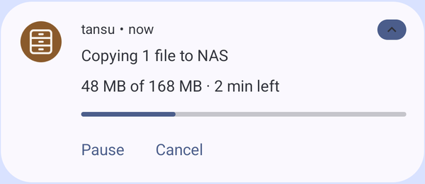
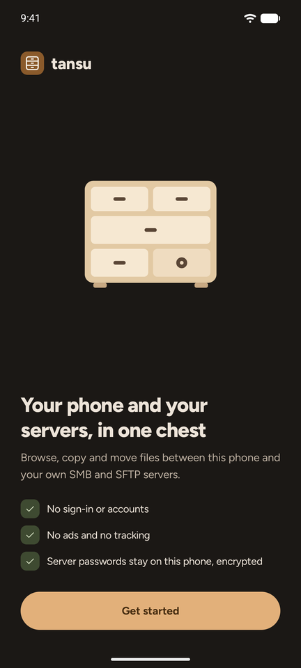
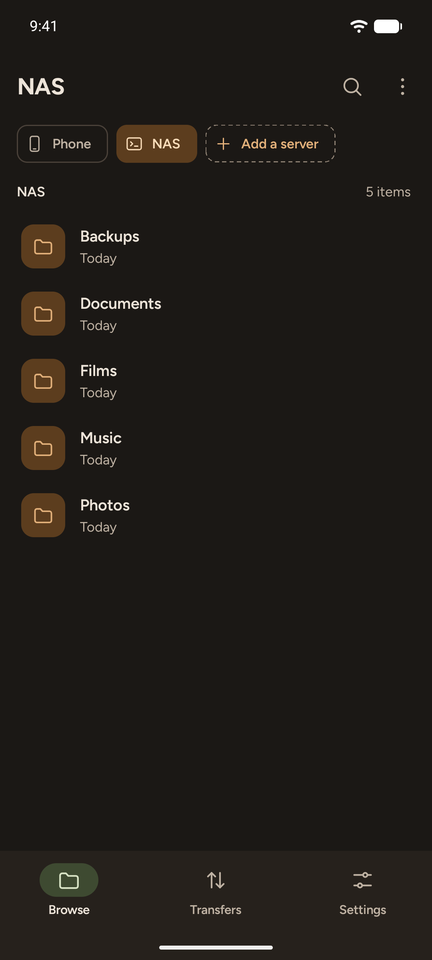
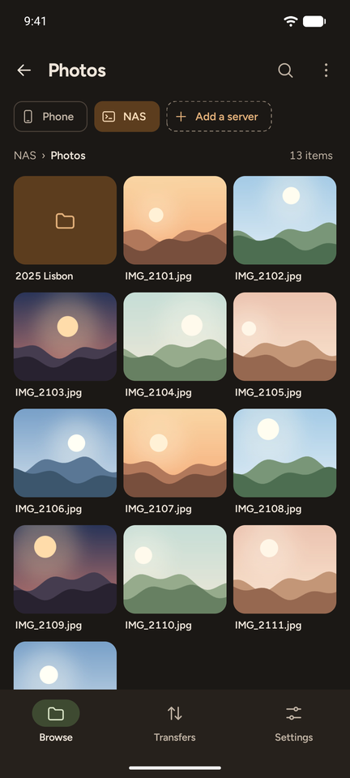
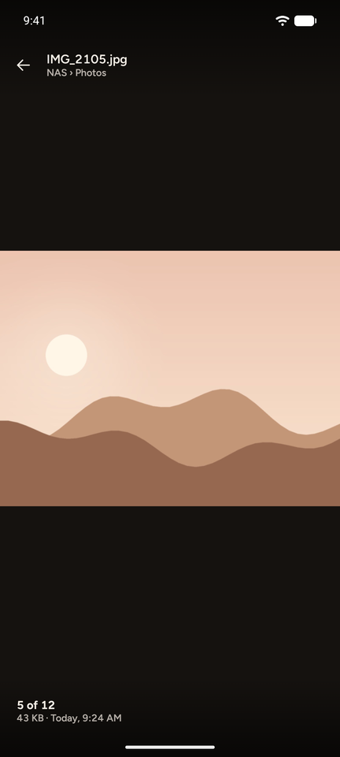

# tansu

**箪笥 · a calm file manager for your phone and your own servers**

A tansu is a Japanese chest of drawers. This one holds your phone's files and the servers you keep
them on, and lets you move them between the two without fuss.

[**Download the latest APK**](https://frankgrobbelaar.github.io/tansu/) ·
[What's new](CHANGELOG.md) · [How it's built](docs/README.md)

## What it does

- Browses your phone's storage from the start.
- Adds your own SMB and SFTP servers, at home or over Tailscale. Each becomes a drawer you browse
  just like the phone.
- Cuts, copies, pastes, renames, deletes and shares files, on the phone and on servers alike.
- Takes any number of files shared from Gallery, My Files or any other app, and saves them to any
  drawer.
- Shows every job as it runs: what it's doing, how far it got and how long is left. Jobs keep going
  when you leave the app, and a copy that breaks off carries on from where it was.
- Opens pictures, videos and PDFs itself, streaming them from servers; anything else opens in
  another app.
- Updates itself from GitHub, checking once a day unless you turn that off.

  

## Light or dark

Kiri, tansu's look, is sand and paper by day and warm near-black by night, with a wood-brown accent
and sage beside it. It follows the phone, or you can pick one, or use your wallpaper's colours.

  
  
  
  

## What it doesn't do

No sign-in, accounts, ads, tracking or automatic backups. Server passwords stay on your phone,
encrypted. Besides your own servers, tansu only talks to GitHub, to look for a new version.

## Getting it

Tansu isn't on any store, on purpose. The
[downloads page](https://frankgrobbelaar.github.io/tansu/) always has the newest APK and explains
installing it the first time. Tansu needs Android 14 or newer.

## Status

Being built in iterations, tracked in [docs/plan.md](docs/plan.md); what changed in each version
is in [CHANGELOG.md](CHANGELOG.md). The [spec](docs/spec.md), the
[architecture](docs/architecture.md) and the [design](docs/design.md) are in
[docs/](docs/README.md). The screenshots are from the emulator, with made-up pictures.

## License

[MIT](LICENSE). Tansu is a personal project and doesn't accept contributions, but you're welcome to
fork it.
